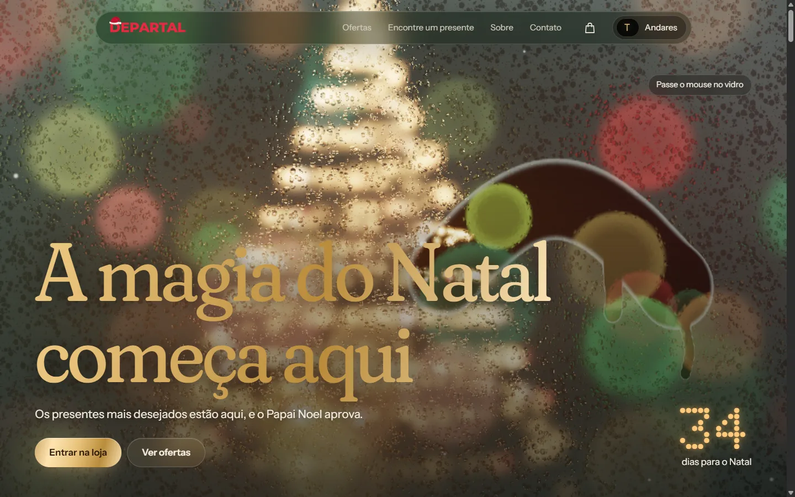
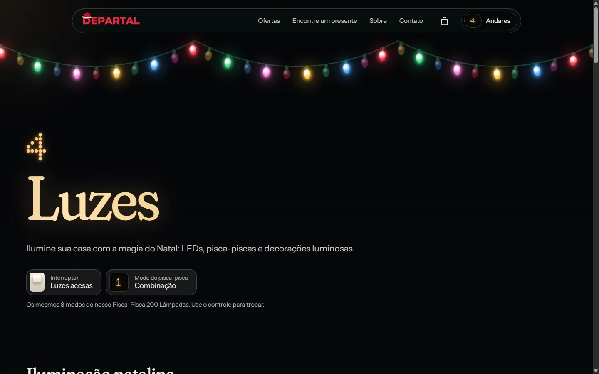

# Departal

Loja de departamento fictícia com tema de Natal. A primeira versão é de 2025. O redesign, de novembro de 2026, transforma o site numa vitrine noturna em que cada categoria é um andar da loja.

## O redesign (2026)

Fica em `redesign/`. Para abrir, `redesign/index.html` no navegador; não precisa de servidor nem de instalação.

- **Vitrine no vidro:** bolas de Natal em WebGL atrás de um vidro embaçado que se limpa com o mouse. Ao lado, a contagem de dias para o Natal.
- **Andares:** cada categoria é um andar, com um painel de elevador para trocar de página, e cada andar tem a sua cena:
  - Decoração: a árvore se monta enquanto a página desce, na ordem certa de decorar.
  - Presentes: faixas de preço com etiquetas penduradas e a tag do embrulho com o nome de quem vai ganhar.
  - Roupas: o provador abre a cortina e o guia calcula o tamanho.
  - Luzes: um varal com interruptor e os 8 modos do pisca-pisca.
  - Guirlandas: a oficina monta a guirlanda em camadas.
  - Presépios: os Reis Magos caminham até a manjedoura conforme os dias passam.
- **Compra:** gôndola de ofertas, busca de presentes pelo quanto se quer gastar e uma sacola guardada no navegador, com pedido simulado.
- **Produtos em 3D:** as fotos dos produtos são renders do Blender, gerados por scripts em Python (ver [Ferramentas](#ferramentas)).

### Tecnologias

HTML, CSS e JavaScript, sem framework. GSAP nas animações (ScrollTrigger, SplitText, Flip, DrawSVG, CustomEase e ScrambleText) e Three.js na vitrine, num build próprio feito com esbuild. As fontes (Fraunces, Instrument Sans e Doto) são servidas pelo próprio site.

## A versão original (2025)

As páginas estão em `html/`, os estilos em `css/` e as imagens em `images/`. Para abrir, `html/home.html`.

## Ferramentas

Os scripts que geraram as imagens e a marca do redesign ficam em `tools/`. As saídas e as dependências não entram no repositório (ver `.gitignore`).

- **`tools/blender/`: o catálogo 3D.**
  - `produtos.py` monta cada produto e roda dentro do Blender: `blender -b --factory-startup -P produtos.py -- --so nome1,nome2 --res 800 --amostras 56 --saida pasta`.
  - `texturas.py` gera as estampas.
  - `converter.py` e `pendurados.py` passam os renders para WebP.
- **`tools/build/`: a marca, o favicon e o Three.js.**
  - `marca.py` desenha a marca e `favicon.py`, o favicon.
  - `three-entrada.js` é a entrada do build do Three.js, feito com esbuild.
  - Antes de usar, rode `npm install` nesta pasta.

As direções visuais estudadas antes do redesign estão em `docs/direcoes-visuais.html`.

## Sobre

Projeto de **Washington Gabriel** ([GitHub](https://github.com/Washington-dev-fullstack)). A versão original é de 2025 e o redesign, de novembro de 2026.
